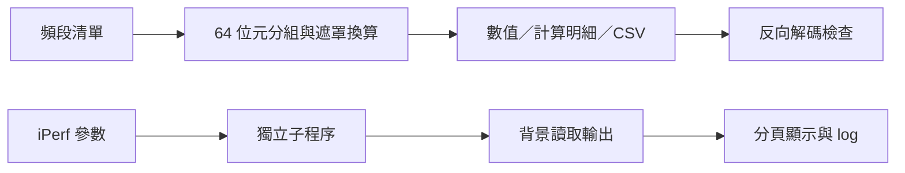

# Network Testing Tools

以 Python／Tkinter 製作的兩個通訊測試輔助工具：**NV Band Preference Center** 負責頻段與位元遮罩換算，**iPerf3 Testing Center** 負責測試參數輸入、程序管理與 log 保存。

這些工具來自 LTE／5G CPE 驗證工作中反覆換算數值、輸入指令及整理輸出的需求。本專案整理程式與可重現的操作範例，供作品審閱及程式閱讀。

## 先看哪裡

| 工具 | 解決的操作問題 | 程式與說明 |
| --- | --- | --- |
| NV Band Preference Center v3 | 把頻段清單轉為分組的 64 位元值，並反向檢查設定 | [主程式](tools/nv/nv_band_preference_tool.py) · [換算範例](docs/nv-tool.md) |
| iPerf3 Testing Center | 在獨立分頁啟動 Server／Client，保留參數與輸出 | [主程式](tools/iperf/iperf_gui.py) · [操作說明](docs/iperf-tool.md) |

NV 主版已整合原本的 3G／4G 版本，日常閱讀與執行請從 v3 開始。[舊版](legacy/README.md)保留於 `legacy/`，用來對照功能整合前後的結構。

## 快速啟動

使用含 Tkinter 的 Python；本次整理以 Windows、Python 3.12.6、Tk 8.6 驗證。GUI 的 Python 程式僅使用標準函式庫，不需安裝 pip 套件。

在下載並解壓的專案根目錄執行：

```powershell
# NV 換算工具：可離線使用
python tools/nv/nv_band_preference_tool.py

# iPerf GUI：執行測試前另備 iperf3
python tools/iperf/iperf_gui.py
```

iPerf GUI 需要外部 `iperf3` 執行檔。安裝方式及 Windows 的支援限制見[操作說明](docs/iperf-tool.md)。本專案沒有附上第三方執行檔或 DLL。

## 程式的重點

NV 工具將輸入解析、64 位元分組、編碼／解碼與畫面分開處理。以第 277 個位置為例，先定位至第 5 個欄位，再設定該欄位的第 21 個位元；對應值為 `2^20 = 1048576`。可用純函式測試確認換算，不需要接上設備。

iPerf GUI 將參數組成命令列陣列，以 `subprocess` 啟動獨立程序。背景執行緒讀取輸出，畫面以 `after()` 排程更新；每次工作有自己的分頁、停止按鈕與 log。多個分頁代表多個程序，與單一 Client 的 `-P` 平行串流是不同層次。



## 使用範圍

- NV 工具是**離線換算器**，沒有連接 modem 或寫入 NV 的功能。程式內的 NV 編號、名稱與位元對應是現有實作設定；使用於實際平台前，仍須核對該平台的欄位定義，尤其 WCDMA／GSM 不能直接假定「頻段號碼等於位元位置」。
- iPerf 的量測由外部 iPerf3 執行；GUI 不自行實作網路流量產生器。範例採本機回送位址，不能當作設備吞吐量成果。
- 此版本不提供排程式批次測試、統計圖表或自動解析吞吐量報表。可手動重複啟動工作。
- 本專案沒有附上原始測試 log、內部試算表或客戶資料，也不宣稱已量化節省工時、降低錯誤率或完成跨平台驗證。

## 驗證

從專案根目錄執行：

```powershell
python -m unittest discover -s tests -v
```

測試涵蓋 NV 換算邊界、非法輸入、CSV 一致性，以及 iPerf 指令建構與 log 建立流程。iPerf 使用替身程序驗證，不啟動網路壓測。實際通過項目與未驗證範圍記錄於[驗證紀錄](docs/verification.md)，修正項目見[變更紀錄](CHANGELOG.md)。

本專案尚未指定開放原始碼授權；第三方 iPerf3 依其自身授權提供。公開展示與授權方式的差異可參考 [GitHub 授權說明](https://docs.github.com/en/repositories/managing-your-repositorys-settings-and-features/customizing-your-repository/licensing-a-repository)。
